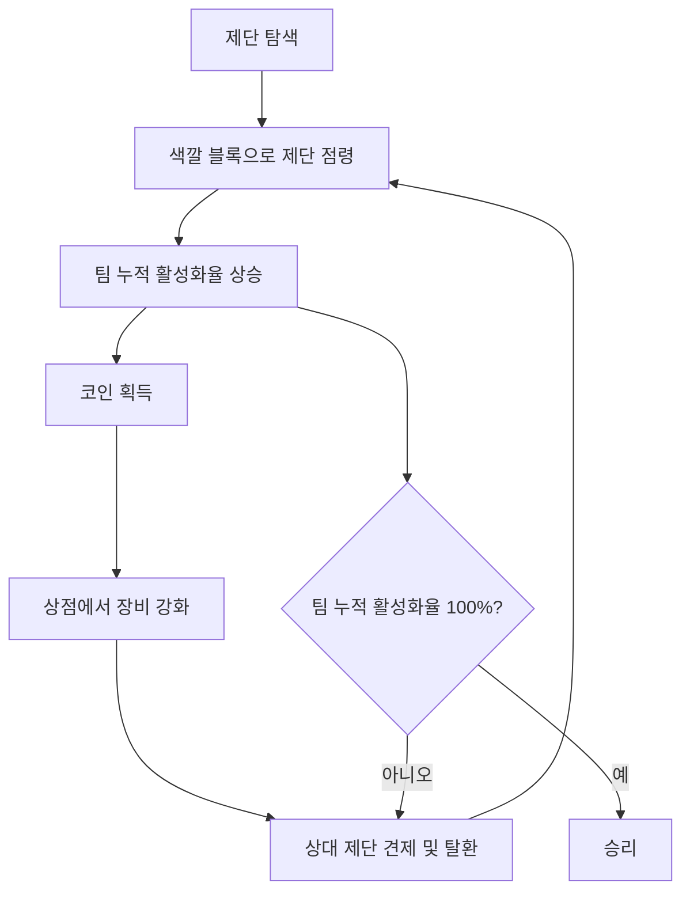

# 게임 개요

## 문서 역할

Mayuela의 게임 정체성, 승리 목표, 핵심 재미 구조를 정의합니다.  
개발팀은 이 문서를 통해 각 시스템이 왜 필요한지 먼저 이해합니다.

## 게임 정의

**Mayuela**는 스페인어 소설 *Rayuela*와 마인크래프트를 합성한 이름입니다.  
플레이어는 2명씩 팀을 이루고, 맵 곳곳의 제단을 팀 색유리로 점령해 팀 누적 활성화율을 100%까지 올려 승리합니다.

## 핵심 플레이 루프

## 핵심 규칙 요약

- 필수 인원은 4명 이상입니다.
- 참가 인원은 짝수만 허용합니다.
- 권장/최대 인원은 10명입니다.
- 게임은 2명씩 팀을 이루는 `2vs2vs2vs2vs2` 구조입니다.
- 각 팀은 고유 색상과 색유리를 받습니다.
- 색유리는 핫바 9번 슬롯에 고정됩니다.
- 팀이 제단을 점령하면 팀 누적 활성화율이 오릅니다.
- 팀이 제단을 많이 점령할수록 활성화율 상승 속도가 빨라집니다.
- 모든 제단을 점령하지 않아도 팀 활성화율 100%에 도달하면 승리합니다.
- 코인은 맵 안 랜덤 위치에 드롭됩니다.
- 게임 중 사망해도 아이템을 모두 잃지 않습니다.

## 연결 문서

- 세션 흐름: [[02-게임-흐름-세션]]
- 제단 규칙: [[04-제단-활성화율]]
- UI 표시: [[05-UI-피드백]]
- 데이터 구조: [[08-데이터-저장구조]]
