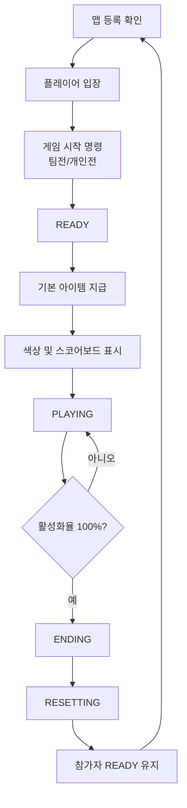

# 게임 흐름과 세션

## 문서 역할

게임 시작부터 종료까지의 상태 전이를 정의합니다.  
서버 개발자는 이 문서를 기준으로 게임 상태 머신을 구현합니다.

## 세션 목록

| 세션 | 역할 |
| --- | --- |
| `WAITING` | 플레이어 입장 대기 |
| `READY` | 게임 시작 전 준비 시간 |
| `PLAYING` | 실제 게임 진행 |
| `ENDING` | 승자 결정 및 결과 처리 |
| `RESETTING` | 맵, 제단, 플레이어 상태 초기화 |

## 전체 흐름

## READY 세션 처리

- `/game 팀전 시작`은 2명 단위 팀을 편성합니다.
- `/game 개인전 시작`은 플레이어마다 1명짜리 팀을 편성합니다.
- `/game 시작`은 기존 호환을 위해 팀전 시작으로 처리합니다.
- 참가자 로비 텔레포트
- 체력, 허기, 상태 이상 초기화
- 인벤토리 정리
- 기본 아이템 지급
- 색깔 블록을 핫바 4번 슬롯에 배치
- 플레이어별 색상 스코어보드 표시
- 시작 카운트다운 출력
- 아이템 버리기와 블록 설치 차단

## PLAYING 세션 처리

- 제단 점령 판정
- 제단 누적 활성화율 계산
- 30초 동안 제단을 설치하지 못한 팀에게 제단 설치 전까지 힘 버프 지급
- 스코어보드 갱신
- 본인 팀 색상과 팀원 목록 표시
- 색깔 블록 lore 갱신
- 제단 위 `TextDisplay` 갱신
- 코인 드롭
- 상점 구매 처리

## 종료 조건

플레이어의 제단 누적 활성화율이 100%에 도달하면 `ENDING`으로 전환합니다.

## ENDING 세션 처리

- 승리 팀을 방송합니다.
- 실제 `PLAYING` 세션의 플레이 타임을 계산합니다.
- 팀별 획득 코인을 합산해 결과 통계를 방송합니다.
- 모든 참가자를 등록된 게임 스폰 위치로 이동시킵니다.
- 게임 아이템, 버프, Display, 코인 드롭 엔티티를 정리합니다.
- 보스바를 제거하고 참가자 스코어보드는 `준비` 상태로 다시 표시합니다.
- 참가자는 자동 퇴장되지 않으며, `/퇴장`을 입력해야 준비가 취소됩니다.

## 연결 문서

- 제단 승리 조건: [[04-제단-활성화율]]
- UI 갱신: [[05-UI-피드백]]
- 예외 처리: [[09-예외처리]]
