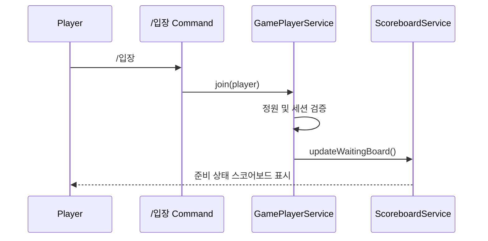
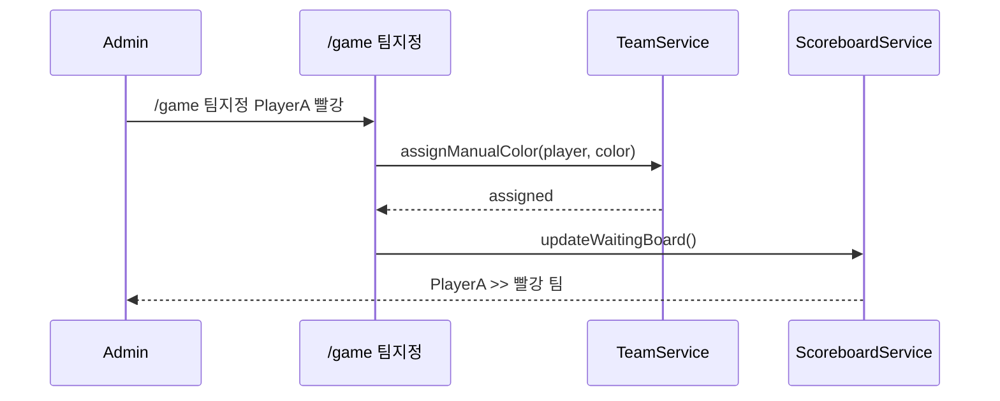
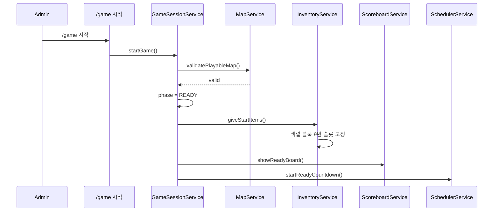
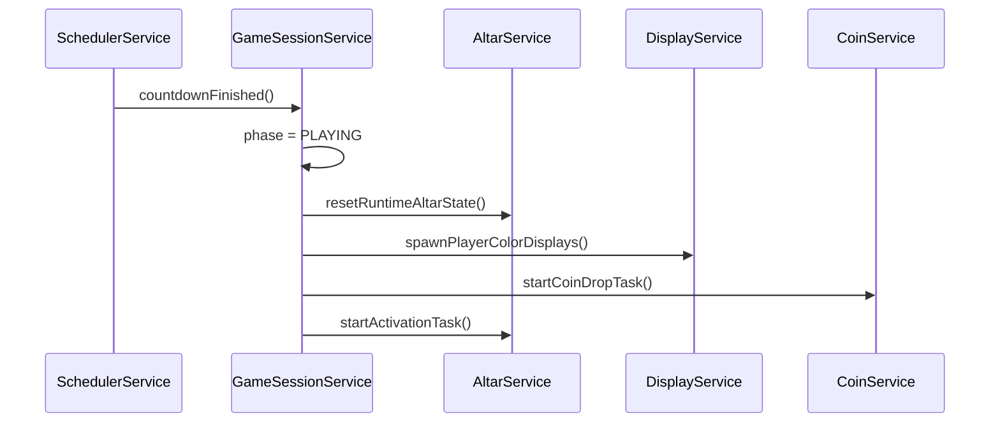
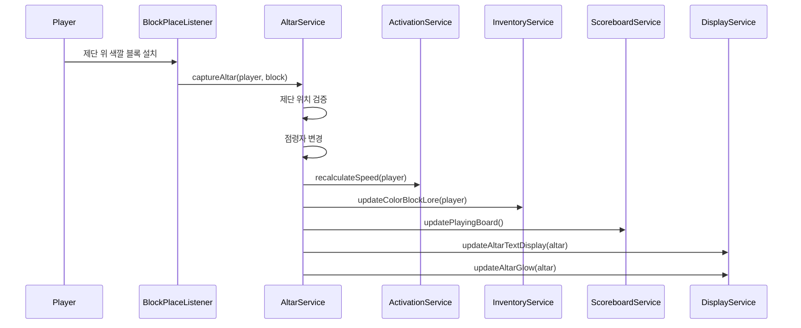
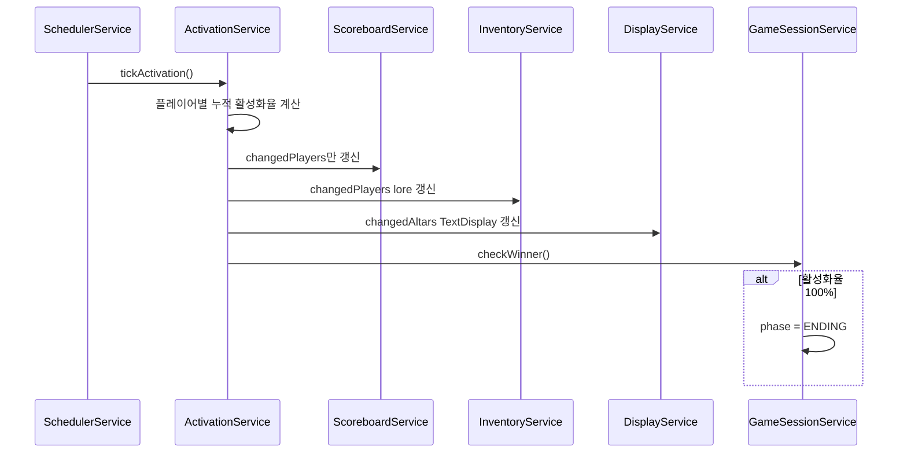
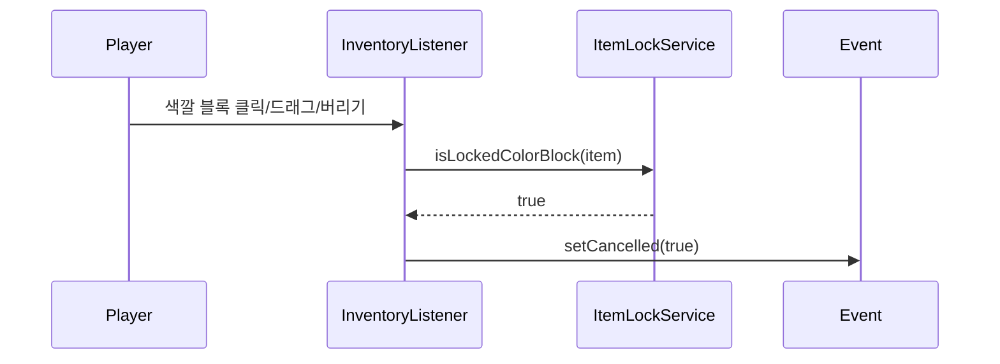
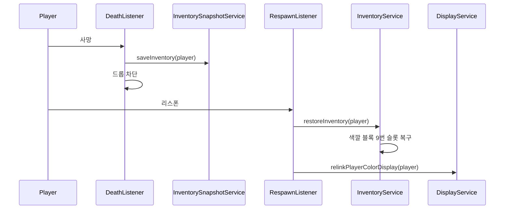
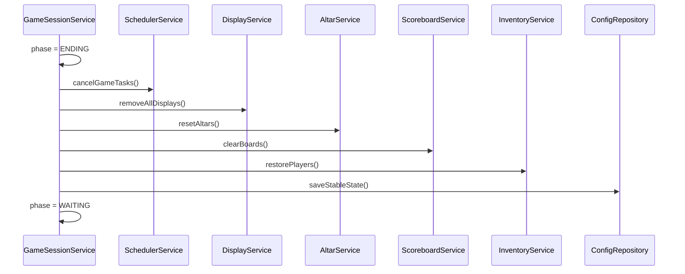

# 시퀀스 다이어그램

## 문서 역할

Mayuela의 주요 유스케이스가 어떤 순서로 실행되는지 정의합니다.  
Paper 이벤트, 서비스 호출, UI 갱신, 상태 저장의 흐름을 맞추기 위한 개발 기준입니다.

## 1. 플레이어 입장

## 1.1. 팀 수동 지정

## 2. 게임 시작

## 3. READY에서 PLAYING 전환

## 4. 제단 점령

## 5. 활성화율 Tick 갱신

## 6. 색깔 블록 이동 차단

## 7. 플레이어 사망과 리스폰

## 8. 게임 종료

## 연결 문서

- 이벤트 처리: [[13-이벤트-처리-매트릭스]]
- Tick/Scheduler 설계: [[14-Tick-Scheduler-설계]]
- 개발 원칙: [[11-개발-원칙]]
