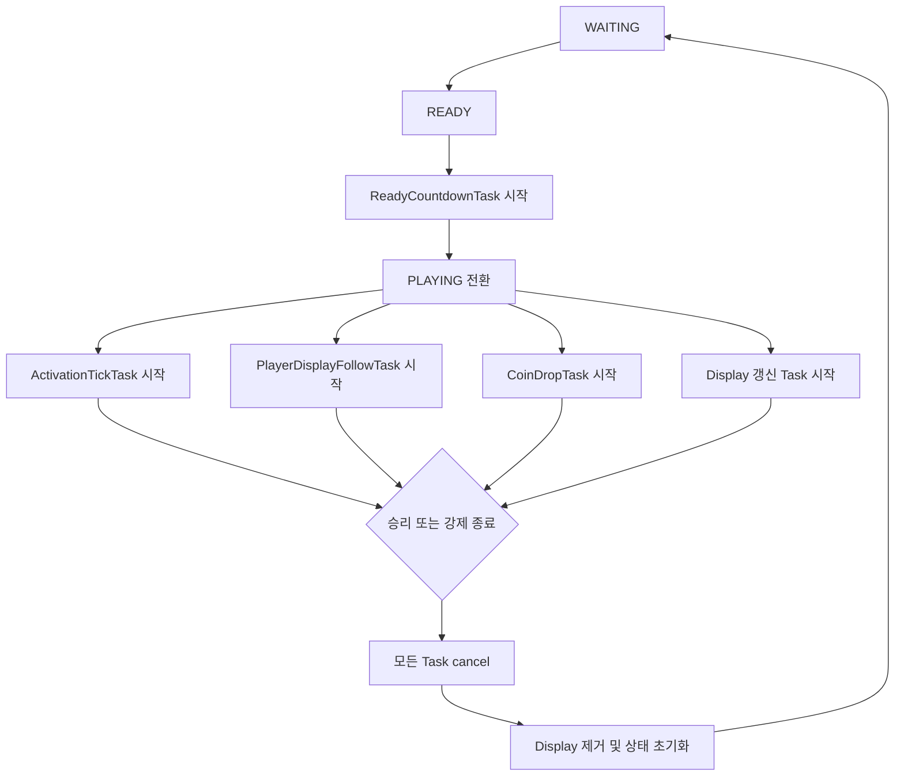

# Tick/Scheduler 설계

## 문서 역할

Mayuela에서 주기적으로 실행되는 작업의 주기, 책임, 시작/종료 시점을 정의합니다.  
TPS 퍼포먼스를 보호하기 위한 핵심 문서입니다.

## Scheduler 설계 원칙

- 모든 tick 작업은 명확한 목적과 종료 시점을 가집니다.
- 게임 세션이 끝나면 관련 task를 반드시 cancel합니다.
- 매 tick 전체 갱신을 피하고, 변경된 대상만 갱신합니다.
- Paper API를 호출하는 작업은 메인 스레드에서 실행합니다.
- 파일 IO는 반복 task에서 수행하지 않습니다.
- 표시 엔티티는 재생성하지 않고 갱신 또는 재사용합니다.

## Task 목록

| Task | 실행 세션 | 주기 | 스레드 | 책임 | 종료 시점 |
| --- | --- | ---: | --- | --- | --- |
| `ReadyCountdownTask` | `READY` | 20 tick | Main | 시작 카운트다운, PLAYING 전환 | PLAYING 전환 |
| `ActivationTickTask` | `PLAYING` | 설정값, 기본 20 tick | Main | 플레이어별 누적 활성화율 계산 | ENDING 전환 |
| `ScoreboardUpdateTask` | `READY`, `PLAYING` | 이벤트 기반 우선, 필요 시 20 tick | Main | 변경된 스코어보드 라인 갱신 | 게임 종료 |
| `ColorBlockLoreSyncTask` | `PLAYING` | 이벤트 기반 우선, 필요 시 20 tick | Main | 색깔 블록 lore 동기화 | 게임 종료 |
| `PlayerDisplayFollowTask` | `PLAYING` | 1~2 tick | Main | 머리 위 `ItemDisplay` 위치 보정 | 게임 종료, 퇴장 |
| `AltarDisplayUpdateTask` | `PLAYING` | 이벤트 기반 우선, 필요 시 20 tick | Main | 제단 위 `TextDisplay` 퍼센트 갱신 | 게임 종료 |
| `CoinDropTask` | `PLAYING` | 인원별 설정값 | Main | 맵 안 참가자 주변 지상 코인 드롭 | 게임 종료 |
| `DroppedCoinCleanupTask` | `PLAYING` | 100~200 tick | Main | 오래된 코인 아이템 정리 | 게임 종료 |

## Task 상세

### ReadyCountdownTask

역할:

- READY 세션 카운트다운 출력
- 시작 전 아이템 지급 여부 확인
- 카운트다운 종료 시 `PLAYING` 전환 요청

주의:

- 카운트다운 중 게임 취소 시 즉시 cancel합니다.

### ActivationTickTask

역할:

- 점령 제단 수를 기준으로 누적 활성화율 증가
- 활성화율 100% 도달 플레이어 확인
- 변경된 플레이어 목록을 UI 서비스에 전달

성능 기준:

- 등록된 참가자와 제단 상태 캐시만 사용합니다.
- 월드 스캔을 하지 않습니다.
- 값이 바뀐 플레이어만 스코어보드와 lore 갱신 대상으로 전달합니다.

### PlayerDisplayFollowTask

역할:

- 플레이어 머리 위 `ItemDisplay`를 따라다니게 합니다.

성능 기준:

- 최대 10명 기준으로만 실행합니다.
- 표시 엔티티를 매번 생성하지 않고 teleport만 수행합니다.
- 퇴장, 사망, 게임 종료 시 display 참조를 정리합니다.

### AltarDisplayUpdateTask

역할:

- 제단 위 `TextDisplay`의 누적 활성화율 텍스트를 갱신합니다.
- 점령자 변경 시 색상과 발광 효과를 갱신합니다.

성능 기준:

- 점령자 또는 퍼센트가 바뀐 제단만 갱신합니다.
- `TextDisplay`는 재생성보다 기존 엔티티 텍스트 변경을 우선합니다.

### CoinDropTask

역할:

- 등록된 맵 안에서 온라인 참가자 주변 지상 위치를 탐색해 코인 아이템을 드롭합니다.
- 공중, 물, 나뭇잎 위치는 제외합니다.
- 인원별 드롭 주기와 금액은 `game.yml`의 `coin.rules`를 기준으로 합니다.

성능 기준:

- 필드에 존재하는 Mayuela 코인 최대 개수를 제한합니다.
- 최대 개수를 초과하면 새 드롭을 건너뛰거나 오래된 코인을 정리합니다.

## Task 생명주기

## 금지 사항

- 매 tick YAML 저장
- 매 tick 모든 스코어보드 라인 재생성
- 매 tick `TextDisplay` 또는 `ItemDisplay` 재생성
- 반복 task 안에서 넓은 범위 월드 스캔
- 비동기 task에서 Bukkit/Paper 엔티티 또는 월드 API 직접 호출

## 연결 문서

- 개발 원칙: [[11-개발-원칙]]
- 시퀀스 다이어그램: [[12-시퀀스-다이어그램]]
- 이벤트 처리: [[13-이벤트-처리-매트릭스]]
