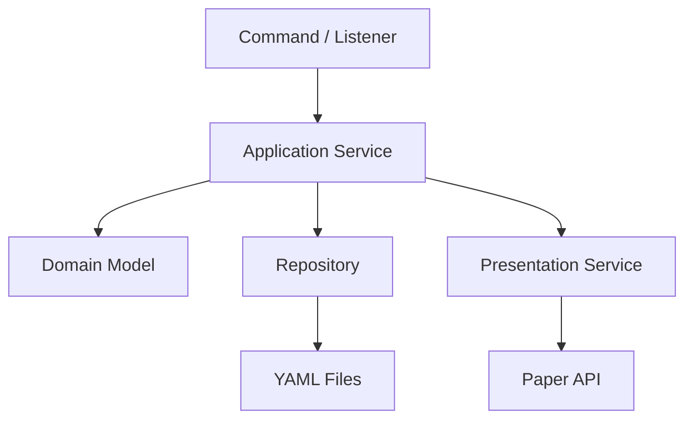

# 컴포넌트와 레이어 설계

## 문서 역할

Mayuela의 코드를 어떤 책임 단위로 나눌지 정의합니다.  
이 문서는 SOLID 원칙을 지키기 위한 실전 기준입니다.

## 핵심 목표

- 한 클래스가 너무 많은 책임을 갖지 않게 합니다.
- Paper 이벤트 리스너에 게임 규칙이 몰리지 않게 합니다.
- UI 표시와 게임 규칙 계산을 분리합니다.
- YAML 저장 로직과 런타임 게임 상태를 분리합니다.
- 나중에 상점, 제단, 점수판 기능을 확장해도 기존 코드가 크게 흔들리지 않게 합니다.

## 권장 레이어



## 레이어별 책임

| 레이어 | 역할 | 예시 |
| --- | --- | --- |
| Command | 명령어 입력 처리 | `/입장`, `/game 시작` |
| Listener | Paper 이벤트 수신 | `BlockPlaceEvent`, `InventoryClickEvent` |
| Application Service | 유스케이스 처리 | 게임 시작, 제단 점령, 사망 복구 |
| Domain Model | 게임 규칙과 상태 표현 | `GamePlayer`, `Altar`, `PlayerColor` |
| Repository | YAML 로드/저장 | `GameConfigRepository` |
| Presentation Service | 사용자 표시 갱신 | 스코어보드, lore, Display |
| Scheduler | 반복 task 실행 | 활성화율 tick, 코인 드롭 |

## 권장 컴포넌트

| 컴포넌트 | 책임 |
| --- | --- |
| `Mayuela` | 플러그인 진입점, 서비스/커맨드/리스너 조립과 등록 |
| `GameSessionService` | 게임 상태 전환, 시작 조건 검증, 시작, 종료 |
| `GamePlayerService` | 참가자 등록, 퇴장, 최대 인원 관리 |
| `TeamService` | 팀 수동 지정, 게임 시작 시 랜덤 팀 편성, 팀 색상 관리 |
| `AltarService` | 제단 등록, 점령, 대체 처리 |
| `ActivationService` | 누적 활성화율 계산, 승리 판정 |
| `InventoryService` | 기본 아이템 지급, 색깔 블록 복구 |
| `ItemLockService` | 색깔 블록 이동 차단 판정 |
| `ScoreboardService` | 시작 전/진행 중 스코어보드 갱신 |
| `DisplayService` | `ItemDisplay`, `TextDisplay`, 발광 효과 관리 |
| `CoinService` | 코인 드롭, 코인 획득 처리 |
| `ShopService` | 상점 NPC, 구매, 업그레이드 처리 |
| `MapService` | 맵 pos1/pos2, 맵 저장, 검증 |
| `LobbyService` | 로비 등록, 텔레포트 |
| `ConfigRepository` | YAML 파일 로드/저장 |
| `SchedulerService` | 반복 task 시작/중지 |

## 의존 방향 규칙

좋은 의존 방향:

```text
Listener -> Service -> Domain
Command -> Service -> Repository
Service -> PresentationService
Service -> Repository
```

피해야 할 의존 방향:

```text
Domain -> Paper API
Domain -> YAML 파일
Repository -> Service
ScoreboardService -> AltarService 직접 변경
Listener -> YAML 직접 저장
```

## 이벤트 리스너 작성 규칙

Listener는 얇게 유지합니다.

좋은 예:

```java
@EventHandler
public void onBlockPlace(BlockPlaceEvent event) {
    altarService.handleBlockPlace(event);
}
```

나쁜 예:

```java
@EventHandler
public void onBlockPlace(BlockPlaceEvent event) {
    // 제단 찾기
    // 점령자 바꾸기
    // 활성화율 계산
    // 스코어보드 수정
    // YAML 저장
    // TextDisplay 생성
}
```

## 1인 개발용 최소 구현 순서

1. Domain Model 작성
2. Repository 작성
3. Service 작성
4. Command/Listener 연결
5. Scheduler 연결
6. UI/Display 연결

## 연결 문서

- 개발 원칙: [[11-개발-원칙]]
- 이벤트 처리: [[13-이벤트-처리-매트릭스]]
- 상태 소유권: [[17-런타임-상태-소유권]]
