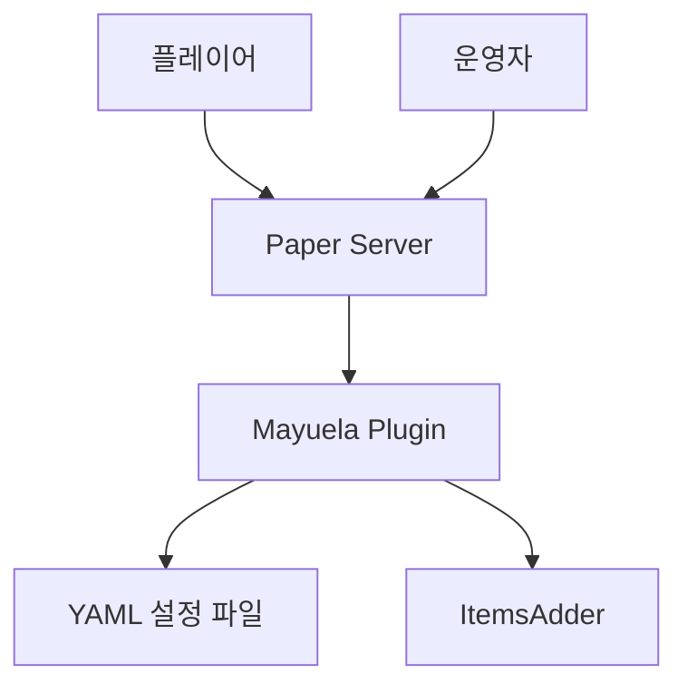
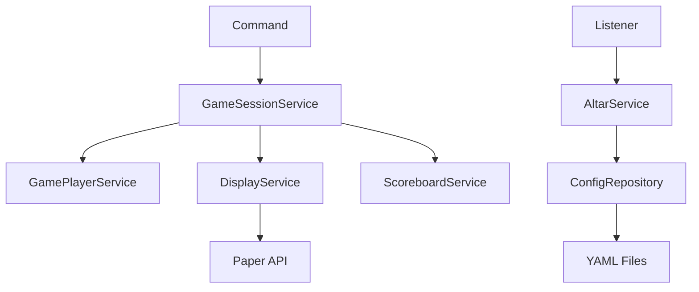

# C4 Model 설명

## 문서 역할

C4 Model이 무엇이고, 어디에 쓰이며, 어디에서 유래했는지 설명합니다.  
Mayuela에서는 C4 Model을 깊게 도입하기보다, 1인 개발자가 큰 구조를 놓치지 않기 위한 가벼운 아키텍처 지도 용도로 사용합니다.

## C4 Model이란

C4 Model은 소프트웨어 아키텍처를 시각화하기 위한 문서화 방식입니다.  
공식 사이트에서는 C4 Model을 개발자 친화적인 아키텍처 다이어그램 접근법으로 설명하며, 핵심은 다음 네 단계입니다.

1. Context
2. Container
3. Component
4. Code

공식 C4 Model 사이트는 이 네 단계가 각각 시스템 컨텍스트, 컨테이너, 컴포넌트, 코드 다이어그램에 대응한다고 설명합니다.  
또한 모든 네 단계가 항상 필요한 것은 아니며, 팀에 가치가 있는 수준만 선택해서 사용하면 됩니다.

출처: [C4 Model 공식 사이트](https://c4model.com/), [C4 Diagrams](https://c4model.com/diagrams)

## C4의 네 단계

### 1. Context

시스템이 바깥 세계와 어떻게 연결되는지 보여줍니다.

Mayuela 예시:

- 플레이어
- 운영자
- Paper 서버
- ItemsAdder
- Mayuela 플러그인

이 단계는 "Mayuela가 누구와 상호작용하는가?"를 설명합니다.

### 2. Container

시스템 내부의 큰 실행 단위와 저장소를 보여줍니다.  
C4에서 Container는 Docker 컨테이너만 의미하지 않습니다. 애플리케이션, 데이터 저장소, 서버 프로세스 같은 실행/저장 단위를 의미합니다.

Mayuela 예시:

- Mayuela Paper Plugin
- YAML 설정 파일
- Paper Server Runtime
- ItemsAdder 리소스/아이템 정의

### 3. Component

플러그인 내부의 주요 책임 단위를 보여줍니다.

Mayuela 예시:

- `GameSessionService`
- `AltarService`
- `ActivationService`
- `ScoreboardService`
- `DisplayService`
- `CoinService`
- `ConfigRepository`

이 단계는 지금 작성한 [[16-컴포넌트-레이어-설계]]와 가장 가깝습니다.

### 4. Code

클래스, 인터페이스, 메서드 수준의 세부 구조입니다.

Mayuela에서는 Code 단계, 즉 클래스 다이어그램은 후순위입니다.  
1인 개발에서는 모든 클래스를 UML로 그리기보다, 복잡한 도메인 모델이 생겼을 때만 필요한 부분만 작성하는 편이 현실적입니다.

## C4 Model은 어디에 쓰이나

C4 Model은 다음 상황에서 유용합니다.

- 프로젝트 구조를 처음 설명할 때
- 신규 개발자가 시스템을 빠르게 이해해야 할 때
- 코드 구현 전에 책임 경계를 합의할 때
- "이 로직을 어디에 넣어야 하는가?"를 판단할 때
- 외부 시스템과의 연동 관계를 설명할 때
- 너무 자세한 UML 없이도 아키텍처를 공유하고 싶을 때

Mayuela에서는 다음 정도로 쓰면 충분합니다.

- Context: Mayuela가 Paper, 플레이어, 운영자, ItemsAdder와 어떻게 연결되는지
- Container: 플러그인, YAML, Paper Runtime의 관계
- Component: 서비스와 저장소의 책임 분리

## C4 Model의 유래

C4 Model은 Simon Brown이 만든 소프트웨어 아키텍처 시각화 방식입니다.  
공식 사이트의 History 문서에 따르면, Simon Brown은 2000년대 중반부터 소프트웨어 아키텍처 워크숍을 진행했고, 참석자들이 각자 그린 아키텍처 그림을 서로 이해하기 어렵다는 문제를 발견했습니다.

그는 UML 대신 여러 수준의 블록 다이어그램을 사용하기 시작했고, 높은 수준의 시스템 그림에서 점점 내부 세부 구조로 내려가는 방식이 잘 작동한다고 보았습니다. 공식 History 문서는 이것이 C4 Model의 뿌리라고 설명합니다.

이후 2010년 QCon London과 IASA London 발표에서 카메라 렌즈 비유와 함께 여러 추상화 수준을 설명했고, 2011년 QCon London 자료에서 C4라는 이름을 처음 확인할 수 있다고 설명합니다. 초기 마지막 C는 Classes였지만, 2018년 무렵 현재처럼 Code로 바뀌었습니다.

출처: [C4 Model History](https://c4model.com/history)

## C4 Model이 UML과 다른 점

| 구분 | UML | C4 Model |
| --- | --- | --- |
| 목적 | 표준화된 모델링 언어 | 아키텍처 설명용 다이어그램 접근법 |
| 학습 난이도 | 상대적으로 높음 | 낮은 편 |
| 표현 방식 | 정해진 표기법이 많음 | 표기법 독립적 |
| 주 사용 대상 | 상세 설계, 분석, 모델링 | 개발자 간 아키텍처 소통 |
| Mayuela 적용 | 후순위 | 컴포넌트 이해에 적합 |

공식 사이트도 C4 Model이 notation independent, tooling independent라고 설명합니다. 즉 특정 도구나 표기법에 묶이지 않고, 목적에 맞게 Mermaid, Structurizr, draw.io 등으로 표현할 수 있습니다.

출처: [C4 Model 공식 사이트](https://c4model.com/)

## Mayuela에서의 권장 사용 방식

1인 개발 기준으로는 아래 세 문서만 있으면 충분합니다.

1. Context 간단 다이어그램
2. Container 간단 다이어그램
3. Component 다이어그램

Code 단계의 클래스 다이어그램은 다음 상황에서만 작성합니다.

- `GamePlayer`, `Altar`, `ActivationState` 관계가 복잡해질 때
- 서비스 간 순환 의존이 생길 때
- 테스트 작성이 어려울 정도로 책임이 흐려질 때

## Mayuela Context 예시

## Mayuela Component 예시

## 결론

C4 Model은 Mayuela에서 "전체 구조를 설명하는 지도" 역할을 합니다.  
클래스 다이어그램을 대체한다기보다, 클래스 다이어그램보다 더 위에서 시스템을 바라보게 해줍니다.

따라서 Mayuela의 현재 단계에서는 C4 Model 중 Context, Container, Component까지만 가볍게 사용하고, Code 단계는 나중에 복잡도가 올라갔을 때 작성하는 것이 좋습니다.
