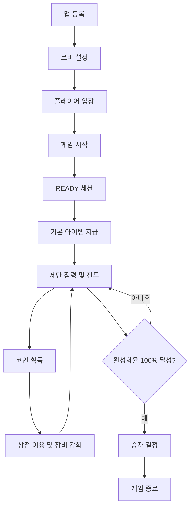

# Mayuela 기획 설계서

## 1. 프로젝트 개요

**Mayuela**는 스페인어 소설 *Rayuela*와 마인크래프트를 합성한 이름입니다.  
한국식 게임 콘셉트로는 **땅따먹기**를 기반으로 하며, 플레이어는 맵에 배치된 제단을 자신의 색깔 블록으로 점령해 활성화율을 올립니다.

모든 제단을 점령하지 않아도, 블록을 올리면 점령율이 올라갑니다.
제단을 먹으면 먹을수록 점령율이 빨라지는 시스템입니다. 100%가 된 플레이어가 1등이 되며, 즉시 게임이 종료됩니다.

## 2. 핵심 콘셉트

- 플레이어는 각자 고유한 색깔 블록을 지급받습니다.
- 맵 곳곳에는 점령 가능한 제단이 존재합니다.
- 제단 위에 자신의 색깔 블록을 올리면 해당 제단이 활성화됩니다.
- 다른 플레이어가 점령한 제단도 자신의 블록으로 대체하여 빼앗을 수 있습니다.
- 점령한 제단 수에 따라 활성화율 상승 속도가 실시간으로 계산됩니다.
- 활성화율은 플레이어의 색깔 블록 아이템 lore에 표시됩니다.
- 상점 NPC는 자신의 앞에 코인 아이템을 지속적으로 떨어뜨립니다.
- 플레이어는 코인으로 장비를 업그레이드하거나 갑옷을 구매할 수 있습니다.

## 3. 게임 기본 정보

| 항목 | 내용 |
| --- | --- |
| 게임 이름 | Mayuela |
| 장르 | 마인크래프트 PvP, 점령전, 성장형 미니게임 |
| 최대 인원 | 10명 |
| 승리 조건 | 제단 활성화율 100% 달성 |
| 주요 시스템 | 제단 점령, 활성화율, 코인, 상점 NPC, 장비 업그레이드 |
| 입장 명령어 | `/입장` |
| 로비 등록 명령어 | `/입장 로비등록` |

## 4. 전체 게임 흐름



## 5. 맵 시스템

### 5.1 맵 등록 조건

맵은 `position1`과 `position2`를 지정하여 저장합니다.  
맵이 등록되어 있어야 게임을 시작할 수 있습니다.

필수 등록 요소는 다음과 같습니다.

| 요소 | 설명 |
| --- | --- |
| `position1` | 맵 영역의 첫 번째 모서리 |
| `position2` | 맵 영역의 두 번째 모서리 |
| 제단 | 플레이어가 점령할 수 있는 오브젝트 |
| 상점 NPC 위치 | 코인 드롭 및 아이템 구매를 위한 NPC 위치 |

### 5.2 맵 관련 명령어

| 명령어 | 설명 |
| --- | --- |
| `/game 맵 pos1` | 현재 위치를 맵의 첫 번째 지점으로 저장 |
| `/game 맵 pos2` | 현재 위치를 맵의 두 번째 지점으로 저장 |
| `/game 맵 저장 <이름>` | 지정된 영역을 맵으로 저장 |
| `/game 제단등록 <이름>` | 현재 위치를 제단으로 등록 |
| `/game 상점등록` | 현재 위치를 상점 NPC 위치로 등록 |

## 6. 로비 시스템

### 6.1 게임 입장

플레이어는 다음 명령어로 게임에 입장합니다.

```text
/입장
```

입장 가능한 인원은 최대 10명입니다. 정원이 찬 경우 추가 입장은 거부됩니다.

### 6.2 로비 등록

관리자는 다음 명령어로 현재 위치를 로비로 등록할 수 있습니다.

```text
/입장 로비등록
```

로비가 등록되면 `game.yml`의 로비 토글이 활성화됩니다.

```yaml
lobby:
  enabled: true
  world: world
  x: 100.5
  y: 64.0
  z: -30.5
  yaw: 90.0
  pitch: 0.0
```

`lobby.enabled`가 `true`인 경우, 게임 시작 시 참가 플레이어들은 등록된 로비 위치로 텔레포트됩니다.

## 7. 게임 세션

게임은 다음 상태를 가집니다.

| 세션 | 설명 |
| --- | --- |
| `WAITING` | 플레이어 입장 대기 |
| `READY` | 게임 시작 전 준비 시간 |
| `PLAYING` | 실제 게임 진행 |
| `ENDING` | 승자 결정 및 종료 처리 |
| `RESETTING` | 게임 데이터 및 맵 상태 초기화 |

### 7.1 READY 세션

게임 시작 시 바로 전투가 시작되면 의도치 않게 게임이 종료될 수 있으므로, `READY` 세션에서 준비 시간을 제공합니다.

`READY` 세션에서 처리할 내용은 다음과 같습니다.

- 참가자 텔레포트
- 기본 아이템 지급
- 인벤토리 정리
- 플레이어 체력 및 상태 초기화
- 참가 플레이어별 색상 스코어보드 표시
- 시작 카운트다운 출력

예시 메시지는 다음과 같습니다.

```text
게임 시작까지 10초
게임 시작까지 5초
게임 시작까지 3초
게임 시작!
```

## 8. 플레이어 시스템

### 8.1 최대 인원

게임 참가 인원은 최대 10명으로 제한합니다.

```yaml
game:
  max-players: 10
```

### 8.2 플레이어 색상

각 플레이어는 입장 또는 게임 시작 시 고유 색상을 배정받습니다.  
색상은 플레이어 구분, 제단 점령, 아이템 lore 표시에 사용됩니다.

플레이어 색상은 마인크래프트 1.21.11의 텍스트 컴포넌트에서 사용할 수 있는 HEX 코드로 관리합니다.  
색상 이름만으로 구분하지 않고, 스코어보드와 아이템 표시에서 동일한 HEX 코드를 사용해 시각적 구분을 명확하게 합니다.

| 순번 | 색상 이름 | 색상 블록 예시 | HEX 코드 |
| ---: | --- | --- | --- |
| 1 | 빨강 | 빨간색 콘크리트 | `#FF3B30` |
| 2 | 파랑 | 파란색 콘크리트 | `#007AFF` |
| 3 | 초록 | 초록색 콘크리트 | `#34C759` |
| 4 | 노랑 | 노란색 콘크리트 | `#FFD60A` |
| 5 | 보라 | 보라색 콘크리트 | `#AF52DE` |
| 6 | 주황 | 주황색 콘크리트 | `#FF9500` |
| 7 | 하늘 | 하늘색 콘크리트 | `#5AC8FA` |
| 8 | 분홍 | 분홍색 콘크리트 | `#FF2D55` |
| 9 | 흰색 | 흰색 콘크리트 | `#F2F2F7` |
| 10 | 검정 | 검은색 콘크리트 | `#1C1C1E` |

### 8.3 게임 시작 전 색상 스코어보드

게임 시작 전에는 모든 참가자에게 플레이어별 색상 정보를 스코어보드로 표시합니다.  
표시 형식은 다음과 같습니다.

```text
[플레이어 이름] >> 색깔
```

예시:

```text
Steve >> 빨강
Alex >> 파랑
Mayu >> 초록
```

스코어보드의 색깔 텍스트는 해당 플레이어에게 배정된 HEX 코드로 표시합니다.  
예를 들어 빨강 플레이어는 `#FF3B30`, 파랑 플레이어는 `#007AFF` 색상으로 색깔 이름을 출력합니다.

Paper 1.21.11에서는 Adventure `Component`와 `TextColor`를 사용해 HEX 색상을 적용합니다.

```java
Component line = Component.text(player.getName() + " >> ")
    .append(Component.text(colorName, TextColor.fromHexString(hexColor)));
```

스코어보드는 다음 시점에 갱신합니다.

- 플레이어가 `/입장`으로 게임에 참가했을 때
- 참가자가 퇴장했을 때
- 게임 시작 전 색상이 재배정되었을 때
- `READY` 세션에 진입했을 때

게임이 `PLAYING` 세션에 진입한 뒤에는 같은 색상 정보를 머리 위 `ItemDisplay` 색깔 블록, 제단 블록, 아이템 lore와 연동합니다.

### 8.4 게임 진행 중 스코어보드

게임 진행 중에는 색깔 블록 정보와 제단 누적 활성화율을 스코어보드에 함께 표시합니다.  
색깔 블록 이름 바로 옆에 해당 플레이어의 현재 제단 누적 활성화율을 표시합니다.

표시 형식은 다음과 같습니다.

```text
[플레이어 이름] >> 색깔블록 이름 누적 활성화율
```

예시:

```text
Steve >> 빨간색 콘크리트 60%
Alex >> 파란색 콘크리트 45%
Mayu >> 초록색 콘크리트 72%
```

색깔 블록 이름에는 플레이어에게 배정된 HEX 코드를 적용하고, 누적 활성화율은 실시간으로 갱신합니다.

## 9. 기본 지급 아이템

게임 시작 시 모든 플레이어에게 다음 아이템을 지급합니다.

| 아이템 | 세부 내용 |
| --- | --- |
| 가죽 헬멧 | 플레이어 색상으로 염색 가능 |
| 가죽 흉갑 | 플레이어 색상으로 염색 가능 |
| 가죽 바지 | 플레이어 색상으로 염색 가능 |
| 가죽 부츠 | 플레이어 색상으로 염색 가능 |
| 철 검 | 기본 근접 무기 |
| 활 | 무한 I 인챈트 적용 |
| 화살 | 1개 지급 |
| 플레이어 색깔 블록 | 핫바 9번 슬롯에 고정 지급 |

활에는 `무한 I` 인챈트를 적용하며, 화살은 1개만 지급합니다.

플레이어 색깔 블록은 제단 점령과 활성화율 표시를 담당하는 핵심 아이템입니다.  
항상 핫바 9번 슬롯에 위치하며, 플레이어가 임의로 이동하거나 버리거나 다른 아이템과 바꿀 수 없습니다.

### 9.1 사망 시 아이템 보존

게임 도중 플레이어가 사망하더라도 보유 중인 아이템을 모두 잃지 않습니다.  
Mayuela 진행 중에는 사망 드롭을 막거나, 사망 직전 인벤토리를 저장한 뒤 리스폰 후 복구합니다.

보존 대상은 다음과 같습니다.

- 기본 지급 장비
- 플레이어 색깔 블록
- 상점에서 구매한 장비
- 업그레이드된 무기
- 보유 중인 코인 아이템
- ItemsAdder 연동 커스텀 아이템

## 10. 제단 시스템

### 10.1 제단 개념

제단은 맵에 배치된 점령 오브젝트입니다.  
플레이어는 자신의 색깔 블록을 제단 위에 올려 제단을 활성화합니다.

### 10.2 제단 점령 규칙

- 제단 위에 플레이어의 색깔 블록이 올라가면 해당 플레이어가 제단을 점령합니다.
- 빈 제단은 누구나 점령할 수 있습니다.
- 이미 점령된 제단도 다른 플레이어가 자신의 색깔 블록으로 대체할 수 있습니다.
- 제단이 대체되면 기존 점령자의 활성화율 상승 속도가 감소합니다.
- 새로 점령한 플레이어의 활성화율 상승 속도가 증가합니다.
- 이미 누적된 활성화율은 즉시 사라지지 않지만, 이후 증가 속도는 현재 점령한 제단 수를 기준으로 다시 계산합니다.

### 10.3 색깔 블록 연동

플레이어의 색깔 블록 아이템과 제단 상태는 실시간으로 연동됩니다.  
플레이어가 제단을 점령하거나 빼앗기면, 해당 플레이어의 색깔 블록 lore와 스코어보드의 누적 활성화율이 즉시 갱신됩니다.

연동되는 정보는 다음과 같습니다.

- 점령한 제단 수
- 전체 제단 수
- 제단 누적 활성화율
- 초당 활성화율 증가량
- 제단 위 `TextDisplay`의 플레이어 이름과 누적 활성화율

색깔 블록은 핫바 9번 슬롯에 고정됩니다.  
인벤토리 클릭, 드래그, 숫자키 교체, 버리기 동작은 이벤트에서 `setCancelled(true)`로 차단합니다.

### 10.4 제단 목록 확인

등록된 제단은 다음 명령어로 확인할 수 있습니다.

```text
/game 제단목록
```

제단 목록에는 제단 이름, 월드 이름, 좌표가 표시됩니다.

예시:

```text
altar_1 - world (20, 65, 20)
altar_2 - world (80, 65, 40)
altar_3 - world (120, 65, 90)
```

### 10.5 제단 활성화 시각 효과

제단 위에 설치된 색깔 블록 위에는 `TextDisplay`를 띄워 현재 점령 상태를 직관적으로 표시합니다.  
텍스트에는 제단을 점령한 플레이어 이름과 해당 플레이어의 제단 누적 활성화율을 표시합니다.

표시 예시는 다음과 같습니다.

```text
Steve
누적 활성화율 60%
```

`TextDisplay`는 색깔 블록 위에 고정되며, 제단 점령자가 변경되거나 활성화율이 갱신될 때 함께 갱신합니다.  
텍스트 색상은 점령 플레이어의 HEX 색상을 적용해 스코어보드, 플레이어 머리 위 색깔 블록, 제단 블록과 동일한 색상 체계를 유지합니다.

제단이 활성화 중임을 더 명확하게 보여주기 위해 색깔 블록 또는 표시 엔티티에 발광 효과를 적용합니다.

발광 효과 규칙은 다음과 같습니다.

- 점령된 제단은 점령 플레이어의 색상으로 발광합니다.
- 비어 있는 제단은 발광하지 않습니다.
- 점령자가 변경되면 기존 표시를 제거하고 새 점령자의 색상과 텍스트로 갱신합니다.
- 활성화율이 누적되는 동안 `TextDisplay`의 퍼센트가 실시간으로 갱신됩니다.
- 게임 종료 또는 맵 초기화 시 제단 위 `TextDisplay`와 발광 효과를 제거합니다.

## 11. 활성화율 시스템

### 11.1 기본 규칙

Mayuela의 활성화율은 단순히 `점령한 제단 수 / 전체 제단 수`로 고정 계산하지 않습니다.  
플레이어는 모든 제단을 점령하지 않아도 제단 위에 자신의 블록을 올리는 순간부터 활성화율을 누적할 수 있습니다.

핵심 규칙은 다음과 같습니다.

- 제단을 1개 이상 점령하면 활성화율이 지속적으로 상승합니다.
- 점령한 제단이 많을수록 활성화율 상승 속도가 빨라집니다.
- 다른 플레이어에게 제단을 빼앗기면 상승 속도가 느려집니다.
- 점령한 제단이 0개가 되면 활성화율 상승이 멈춥니다.
- 활성화율이 100%에 도달하면 해당 플레이어가 승리합니다.

### 11.2 상승 속도 공식

활성화율은 일정 주기마다 누적됩니다.

```text
틱당 활성화율 증가량 = 기본 증가량 * 점령한 제단 수
```

예시 설정은 다음과 같습니다.

```yaml
altar:
  activation-tick-seconds: 1
  base-increase-per-altar: 1.0
```

위 설정은 1초마다 점령한 제단 1개당 활성화율이 1%씩 증가한다는 의미입니다.

### 11.3 계산 예시

맵에 제단이 5개 있고, 기본 증가량이 1초당 1%라고 가정합니다.

| 점령 제단 수 | 초당 증가량 | 100%까지 걸리는 시간 |
| ---: | ---: | ---: |
| 0개 | 0% | 진행 불가 |
| 1개 | 1% | 100초 |
| 2개 | 2% | 50초 |
| 3개 | 3% | 약 34초 |
| 4개 | 4% | 25초 |
| 5개 | 5% | 20초 |

A 플레이어가 제단 1개만 점령해도 활성화율은 오릅니다.  
다만 제단을 많이 점령할수록 더 빠르게 100%에 도달합니다.

### 11.4 제단 대체 예시

기본 증가량이 1초당 1%이고, A 플레이어의 현재 활성화율이 60%라고 가정합니다.

| 상황 | A 플레이어 점령 제단 | A 플레이어 초당 증가량 | A 플레이어 현재 활성화율 |
| --- | ---: | ---: | ---: |
| A가 5개 점령 | 5개 | 5% | 60% |
| B가 1개 대체 | 4개 | 4% | 60% |
| B가 2개 대체 | 3개 | 3% | 60% |
| B가 전부 대체 | 0개 | 0% | 60% |

제단을 빼앗기면 기존 활성화율이 바로 차감되는 것이 아니라, 이후 활성화율이 오르는 속도가 줄어듭니다.  
모든 제단을 빼앗겨 점령한 제단이 0개가 되면 현재 활성화율은 유지되지만 더 이상 증가하지 않습니다.

### 11.5 스코어보드 표시

제단 누적 활성화율은 아이템 lore뿐만 아니라 스코어보드에도 표시합니다.  
게임 진행 중에는 플레이어 색깔 블록 이름 바로 옆에 누적 활성화율을 붙여 표시합니다.

```text
Steve >> 빨간색 콘크리트 60%
Alex >> 파란색 콘크리트 45%
```

스코어보드 갱신 조건은 다음과 같습니다.

- 활성화율 누적 틱이 실행되었을 때
- 제단 점령자가 변경되었을 때
- 플레이어가 사망 후 리스폰했을 때
- 플레이어가 게임에서 퇴장했을 때

### 11.6 제단 위 TextDisplay 표시

스코어보드와 아이템 lore 외에도, 점령된 제단 위에 월드 내 `TextDisplay`를 표시합니다.  
이를 통해 플레이어는 멀리서도 어떤 제단이 누구에 의해 활성화되고 있는지 확인할 수 있습니다.

표시 항목은 다음과 같습니다.

- 점령 플레이어 이름
- 제단 누적 활성화율
- 점령 플레이어 색상
- 활성화 중임을 나타내는 발광 효과

예시:

```text
Alex
누적 활성화율 45%
```

## 12. 아이템 Lore 표시

제단 활성화율은 플레이어의 색깔 블록 아이템 lore에 실시간으로 표시합니다.
색깔 블록 아이템은 제단과 연동되는 고정 아이템이며, 핫바 9번 슬롯에서만 유지됩니다.

### 12.1 Lore 예시

```text
Mayuela 제단 블록
이 블록을 제단 위에 올리면 제단을 활성화할 수 있습니다.

현재 활성화율: 60%
점령한 제단: 3 / 5
초당 증가량: 3%
```

### 12.2 Lore 갱신 조건

Lore는 다음 상황에서 갱신합니다.

- 플레이어가 제단을 새로 점령했을 때
- 다른 플레이어가 자신의 제단을 빼앗았을 때
- 전체 제단 상태가 변경되었을 때
- 게임 진행 중 주기적으로 상태를 갱신할 때

### 12.3 색깔 블록 이동 차단

색깔 블록은 플레이어가 조작할 수 없는 고정 아이템입니다.  
다음 행동은 모두 취소 처리합니다.

- 인벤토리에서 색깔 블록 클릭
- 색깔 블록 드래그
- 숫자키로 다른 슬롯과 교체
- Q 키로 버리기
- 사망 또는 리스폰 과정에서 슬롯 위치가 변경되는 상황

Paper 이벤트 처리 기준은 다음과 같습니다.

```java
event.setCancelled(true);
```

차단 이벤트 예시는 다음과 같습니다.

- `InventoryClickEvent`
- `InventoryDragEvent`
- `PlayerDropItemEvent`
- `PlayerSwapHandItemsEvent`
- `PlayerDeathEvent`
- `PlayerRespawnEvent`

리스폰 후에는 색깔 블록이 다시 핫바 9번 슬롯에 존재하는지 확인하고, 없거나 위치가 바뀐 경우 즉시 복구합니다.

## 13. 상점 NPC 및 코인 시스템

### 13.1 상점 NPC 역할

맵에는 상점 NPC가 존재합니다.  
상점 NPC는 자신의 앞에 코인 아이템을 지속적으로 떨어뜨립니다.  
플레이어는 NPC 앞에 떨어진 코인을 직접 주워 획득하고, 획득한 코인으로 아이템을 업그레이드하거나 갑옷을 구매할 수 있습니다.

### 13.2 코인 드롭

코인은 일정 시간마다 상점 NPC 앞 위치에 아이템 형태로 드롭됩니다.  
플레이어는 드롭된 코인을 직접 주워야 하며, 코인을 주운 플레이어의 보유 코인이 증가합니다.

```yaml
coin:
  drop-interval-seconds: 10
  drop-amount: 5
  drop-offset:
    forward: 1.5
    up: 0.5
```

위 설정은 10초마다 상점 NPC가 바라보는 방향 앞 1.5칸, 위 0.5칸 위치에 코인 5개를 떨어뜨린다는 의미입니다.

### 13.3 코인 표시

플레이어가 주운 코인은 스코어보드, 액션바, 또는 상점 UI에서 표시할 수 있습니다.

```text
보유 코인: 35
```

## 14. 상점 아이템 설계

### 14.1 무기 업그레이드

| 아이템 | 비용 | 설명 |
| --- | ---: | --- |
| 철 검 강화 I | 20코인 | 근접 공격력 증가 |
| 철 검 강화 II | 40코인 | 추가 근접 공격력 증가 |
| 활 강화 I | 25코인 | 원거리 피해량 증가 |
| 활 강화 II | 50코인 | 추가 원거리 피해량 증가 |

### 14.2 방어구 구매

| 아이템 | 비용 | 설명 |
| --- | ---: | --- |
| 철 헬멧 | 20코인 | 방어력 증가 |
| 철 흉갑 | 35코인 | 방어력 증가 |
| 철 바지 | 30코인 | 방어력 증가 |
| 철 부츠 | 15코인 | 방어력 증가 |
| 다이아몬드 방어구 세트 | 고가 | 후반용 고성능 장비 |

### 14.3 기타 아이템

| 아이템 | 비용 | 설명 |
| --- | ---: | --- |
| 회복 아이템 | 15코인 | 체력 회복 |
| 추가 화살 | 10코인 | 예비 화살 지급 |
| 제단 보호 아이템 | 50코인 | 일정 시간 제단 대체 방지 |
| 이동 속도 버프 | 30코인 | 짧은 시간 동안 이동 속도 증가 |

## 15. 승리 및 종료 조건

플레이어의 제단 활성화율이 100%에 도달하면 즉시 승리합니다.  
이때 모든 제단을 점령할 필요는 없으며, 점령한 제단 수에 따라 누적된 활성화율이 100%가 되면 됩니다.

```text
A 플레이어의 제단 활성화율이 100%에 도달했습니다.
A 플레이어가 Mayuela에서 승리했습니다.
```

승리자가 결정되면 게임은 `ENDING` 세션으로 전환됩니다.  
이후 보상 지급, 결과 출력, 맵 초기화, 플레이어 상태 복구를 진행합니다.

## 16. 데이터 저장 구조

### 16.1 game.yml

```yaml
game:
  max-players: 10
  ready-time-seconds: 10

lobby:
  enabled: true
  world: world
  x: 100.5
  y: 64.0
  z: -30.5
  yaw: 90.0
  pitch: 0.0

coin:
  drop-interval-seconds: 10
  drop-amount: 5
  drop-offset:
    forward: 1.5
    up: 0.5

altar:
  activation-tick-seconds: 1
  base-increase-per-altar: 1.0
```

### 16.2 maps.yml

```yaml
maps:
  mayuela_01:
    world: world
    position1:
      x: 0
      y: 60
      z: 0
    position2:
      x: 200
      y: 100
      z: 200
    altars:
      altar_1:
        x: 20
        y: 65
        z: 20
      altar_2:
        x: 80
        y: 65
        z: 40
      altar_3:
        x: 120
        y: 65
        z: 90
    shop:
      x: 100
      y: 65
      z: 100
      yaw: 180.0
      pitch: 0.0
```

### 16.3 alter.yml

`alter.yml`에는 게임에 추가된 제단의 위치와 월드 이름을 저장합니다.

```yaml
altars:
  altar_1:
    world: world
    x: 20
    y: 65
    z: 20
  altar_2:
    world: world
    x: 80
    y: 65
    z: 40
  altar_3:
    world: world
    x: 120
    y: 65
    z: 90
```

### 16.4 players.yml

```yaml
players:
  player-uuid:
    name: PlayerA
    color: RED
    color-name: 빨강
    color-hex: "#FF3B30"
    coins: 35
    activation-rate: 60.0
    captured-altars:
      - altar_1
      - altar_2
```

### 16.5 items.yml

`items.yml`에는 Mayuela에서 사용하는 기본 아이템, 상점 아이템, 커스텀 아이템 정보를 저장합니다.  
`model_id`를 통해 ItemsAdder와 연동할 수 있습니다.

```yaml
items:
  altar_block_red:
    display-name: 빨간색 제단 블록
    material: RED_CONCRETE
    model_id: mayuela:altar_block_red
    keep-on-death: true
  coin:
    display-name: 코인
    material: GOLD_NUGGET
    model_id: mayuela:coin
    keep-on-death: false
  iron_sword:
    display-name: 기본 철 검
    material: IRON_SWORD
    model_id: mayuela:iron_sword
    keep-on-death: true
```

## 17. 명령어 설계

| 명령어 | 설명 | 권한 |
| --- | --- | --- |
| `/입장` | 게임 입장 | 모든 플레이어 |
| `/입장 로비등록` | 현재 위치를 로비로 등록 | 관리자 |
| `/game 시작` | 게임 시작 | 관리자 |
| `/game 종료` | 게임 강제 종료 | 관리자 |
| `/game 맵 position1` | 맵 첫 번째 지점 지정 | 관리자 |
| `/game 맵 position2` | 맵 두 번째 지점 지정 | 관리자 |
| `/game 맵 저장 <이름>` | 맵 저장 | 관리자 |
| `/game 제단등록 <이름>` | 현재 위치를 제단으로 등록 | 관리자 |
| `/game 제단목록` | 등록된 제단의 이름, 월드, 좌표 목록 확인 | 관리자 |
| `/game 상점등록` | 현재 위치를 상점 NPC 위치로 등록 | 관리자 |

## 18. 구현 체크리스트

- [ ] 게임 세션 상태 모델 구현
- [ ] 플레이어 입장 및 최대 인원 제한 구현
- [ ] 로비 등록 및 텔레포트 구현
- [ ] 맵 position1, position2 저장 구현
- [ ] 제단 등록 및 점령 판정 구현
- [ ] `/game 제단목록` 명령어 구현
- [ ] `alter.yml` 제단 위치 및 월드 저장 구현
- [ ] 제단 위 TextDisplay 생성 및 갱신 구현
- [ ] 점령 제단 발광 효과 구현
- [ ] 플레이어별 색상 블록 지급 구현
- [ ] 색깔 블록 핫바 9번 슬롯 고정 구현
- [ ] 색깔 블록 이동, 드래그, 버리기 이벤트 차단 구현
- [ ] 색깔 블록과 제단 상태 실시간 연동 구현
- [ ] 게임 시작 전 플레이어 색상 스코어보드 구현
- [ ] 게임 진행 중 색깔 블록 이름 및 누적 활성화율 스코어보드 표시 구현
- [ ] 1.21.11 HEX 코드 기반 색상 표시 구현
- [ ] 제단 수 기반 활성화율 상승 속도 계산 구현
- [ ] 색상 블록 lore 실시간 갱신 구현
- [ ] 사망 시 게임 아이템 보존 및 리스폰 복구 구현
- [ ] READY 세션 및 카운트다운 구현
- [ ] 기본 아이템 지급 구현
- [ ] `items.yml` model_id 기반 ItemsAdder 연동 구현
- [ ] 상점 NPC 등록 구현
- [ ] 상점 NPC 앞 코인 아이템 드롭 구현
- [ ] 상점 구매 및 장비 업그레이드 구현
- [ ] 승리 조건 및 게임 종료 처리 구현
- [ ] 게임 종료 후 상태 초기화 구현

## 19. 추후 확장 아이디어

- 제단별 특수 효과
- 팀전 모드
- 제단 보호막 시스템
- 플레이어 처치 보상 코인
- 보스바를 통한 활성화율 표시
- 시즌 랭킹 시스템
- 관전자 모드
- 맵 투표 시스템
