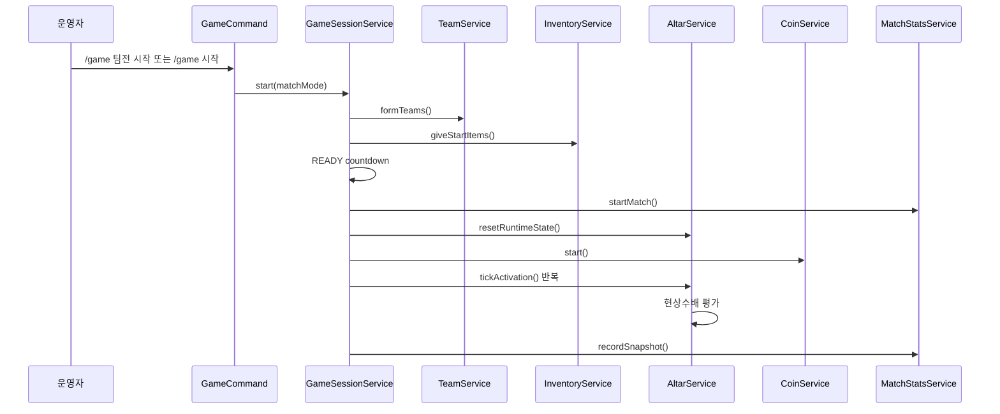

# 현재 구현 맵

이 문서는 현재 코드베이스를 유지보수하기 위한 지도입니다. 새 개발자는 기능을 바꾸기 전에 이 문서로 어느 서비스가 어떤 상태를 소유하는지 먼저 확인해야 합니다.

## 엔트리포인트

메인 클래스:

- `src/main/java/org/minecraft/eden/Eden/mayuela/Mayuela.java`

역할:

- `ConfigRepository` 로드
- 서비스 인스턴스 생성
- 커맨드 등록
- 리스너 등록
- 플러그인 종료 시 강제 정리

현재 구조는 작은 프로젝트에서 흔히 쓰는 수동 조립 방식입니다. Spring 같은 DI 컨테이너는 없고, `Mayuela`가 Composition Root 역할을 합니다.

주의:

- 서비스 생성 순서가 의존성 순서입니다.
- 새 서비스를 추가할 때 `Mayuela` 생성자 주입 순서가 길어집니다.
- 순환 의존을 만들지 않는 것이 중요합니다.

## 주요 서비스 책임

| 클래스 | 책임 | 상태 소유 |
| --- | --- | --- |
| `ConfigRepository` | `game.yml`, `alter.yml`, `maps.yml`, `model.yml` 로드/저장 | 설정값 |
| `GamePlayerService` | 참가자 등록/조회/삭제 | 참가자 목록 |
| `TeamService` | 팀 구성, 수동 색상 지정, 팀 조회 | 팀 목록, 수동 색상 |
| `GameSessionService` | WAITING/READY/PLAYING/ENDING 흐름, 스케줄러 시작/중지 | 게임 페이즈, 시작 시간, 태스크 |
| `AltarService` | 제단 등록, 점령/파괴, 활성화율, 힘 버프, 현상수배 | 제단 런타임 상태, 현상수배 판정 |
| `InventoryService` | 시작 아이템, 제단 아이템, 갑옷, F 슬롯 아이템, 인벤토리 복구 | 인벤토리 스냅샷 |
| `CoinService` | 필드 코인 드랍/획득/만료, 코인 아이템 생성, 코인 모니터링 | 필드 코인 추적 맵 |
| `ShopService` | 상점 GUI, 구매, 상점 아이템 생성, 코인 차감 | 상점 구매 로직 |
| `DisplayService` | 플레이어 머리 위 ItemDisplay, 현상수배 TextDisplay, 제단 TextDisplay | DisplayEntity 맵 |
| `ScoreboardService` | 스코어보드, 보스바, 현상수배 라인, 팀 발광용 Scoreboard Team | BossBar |
| `MatchStatsService` | 매치 이벤트 통계 저장 | 이벤트 버퍼, 스냅샷 |
| `RespawnProtectionService` | 부활 이동 잠금, 무적, 반복 타격 방어 | 보호 상태 |
| `PdcMonitorService` | 운영자 PDC 태그 확인 | 없음 |

## 주요 리스너 책임

| 리스너 | 이벤트 | 핵심 처리 |
| --- | --- | --- |
| `AltarBlockListener` | `PlayerInteractEvent`, `BlockBreakEvent` | 신호기 GUI 차단, 제단 강제 설치, 제단 파괴 |
| `CoinListener` | `EntityPickupItemEvent` | 추적 중인 필드 코인만 획득 처리 |
| `ItemLockListener` | 클릭/드래그/드롭/F키 | 제단 아이템, 코인, F 슬롯 아이템 보호 |
| `PlayerLifecycleListener` | 사망/부활/접속/퇴장/피해/허기 | 인벤토리 유지, 스폰킬 방지, 현상수배 보상 |
| `ShopListener` | NPC/GUI 상호작용 | 상점 열기, 구매 클릭 |
| `ShopItemListener` | 상점 아이템 사용/타격 | 밀치기, 점프강화, 저항 아이템 |

## 런타임 흐름



## 현상수배 현재 구현

판정 위치:

- `AltarService.tickActivation()` 이후
- `AltarService.capture()`
- `AltarService.breakAltarBlock()`
- `AltarService.releaseTeam()`

현재 기준:

- 랭킹 1등 팀과 2등 팀의 활성화율 차이를 계산합니다.
- `bounty.warmup-seconds` 이전에는 발동하지 않습니다.
- 1등 활성화율이 `bounty.min-leader-activation-percent` 미만이면 발동하지 않습니다.
- 리드 격차가 `bounty.activate-gap-percent` 이상이면 발동 가능합니다.
- 현상수배 중인 팀이 1등이 아니게 되거나 격차가 `bounty.release-gap-percent` 이하가 되면 해제합니다.
- 보상은 `bounty.reward-coins`입니다.

운영자 모니터링:

- `/game 모니터링`
- `AltarService.bountyMonitoringLines(gameSessionService.playElapsedSeconds())`

주의:

- 일반 플레이어 메시지에는 리드 격차를 노출하지 않습니다.
- 기존 문서의 “제단 3개 이상 현상수배”는 오래된 기준입니다.

## 코인 현재 구현

필드 코인 드랍:

- `CoinService.start()`가 인원수별 드랍 주기로 task를 시작합니다.
- 매 주기마다 온라인 참가자 중 맵 안에 있는 플레이어 1명을 앵커로 선택합니다.
- 앵커 주변 `coin.search-radius-blocks` 반경에서 지상 위치를 찾습니다.
- 성공하면 필드 코인을 드랍하고 `droppedCoins`에 추적합니다.

필드 코인 표시:

- 코인 엔티티는 `glowing` 상태입니다.
- 코인 위에는 `TextDisplay`가 생성됩니다.
- 문구는 `n초 뒤 제거됩니다.`입니다.
- 1초마다 남은 시간이 갱신됩니다.
- 획득/만료/게임 종료 시 TextDisplay도 제거합니다.

ItemsAdder:

- `model.yml`
- `system-items.field_coin.itemsadder-id`
- fallback: `GOLD_NUGGET`

PDC:

- `mayuela:coin`
- `mayuela:coin_itemsadder_id`

## 제단 현재 구현

제단 등록:

- `/game 제단등록 <id>`
- 저장 파일: `alter.yml`

설치:

- 플레이어가 신호기를 바라보고 제단 아이템을 사용합니다.
- 신호기 GUI는 게임 중 차단됩니다.
- 서버가 신호기 위에 제단 블록을 강제 배치합니다.

파괴:

- 맨손 또는 모든 아이템으로 제단 블록을 부술 수 있습니다.
- 일반 블록 파괴는 게임 중 차단합니다.
- 제단 파괴 시 드랍은 나오지 않습니다.

## 설정 파일

| 파일 | 용도 |
| --- | --- |
| `game.yml` | 게임, 코인, 상점, 버프, 현상수배 설정 |
| `alter.yml` | 제단 위치 |
| `maps.yml` | 맵 position1/position2 |
| `model.yml` | ItemsAdder id와 fallback material |

중요 설정:

```yaml
bounty:
  enabled: true
  warmup-seconds: 120
  min-leader-activation-percent: 20.0
  activate-gap-percent: 10.0
  release-gap-percent: 7.0
  transition-cooldown-seconds: 30
  reward-coins: 8
```

```yaml
system-items:
  field_coin:
    itemsadder-id: mayuela:field_coin
    fallback-material: GOLD_NUGGET
```

## 통계 파일

저장 위치:

```text
plugins/mayuela/stats/matches/<match-id>.yml
```

주요 이벤트:

- `MATCH_STARTED`
- `MATCH_FINISHED`
- `ALTAR_CAPTURED`
- `ALTAR_TAKEN`
- `ALTAR_BROKEN`
- `COIN_DROPPED`
- `COIN_PICKED_UP`
- `COIN_EXPIRED`
- `SHOP_PURCHASED`
- `SHOP_PURCHASE_FAILED`
- `PLAYER_DEATH`
- `PLAYER_JOINED`
- `PLAYER_QUIT`

현재 통계 설정에는 코인 룰과 현상수배 설정이 포함됩니다.

## 명령어 유지보수 포인트

주요 관리자 명령:

- `/game 시작`
- `/game 팀전 시작`
- `/game 개인전 시작`
- `/game 종료`
- `/game reload`
- `/game 맵 pos1`
- `/game 맵 pos2`
- `/game 맵 저장 <id>`
- `/game 제단등록 <id>`
- `/game 제단목록`
- `/game 상점등록`
- `/game 스폰등록`
- `/game 팀지정 <player> <color>`
- `/game 팀해제 <player>`
- `/game 모니터링`
- `/game pdc`
- `/game pdc 인벤토리`
- `/game 코인설정 <1-10> <주기초> <금액>`
- `/game 코인제거 <초>`
- `/game 코인최대 <개수>`
- `/game 넉백설정 <블록>`
- `/game 막대기최대 <개수>`

플레이어 명령:

- `/입장`
- `/퇴장`
- `/상점열기`
- `/은행열기` 요청이 있었으므로 실제 command/plugin.yml 등록 여부를 확인해야 합니다.

## 빌드 확인

```powershell
.\gradlew.bat compileJava
```

현재 세션 기준으로 마지막 컴파일은 성공했습니다.
